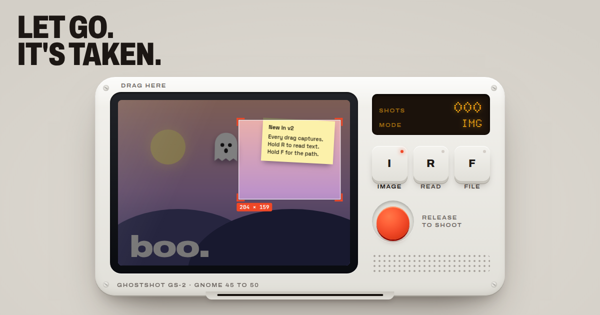
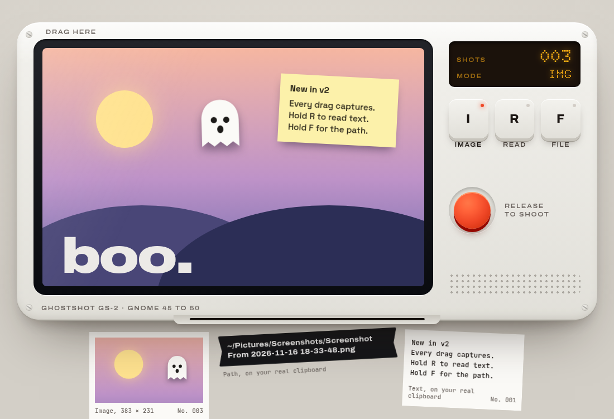
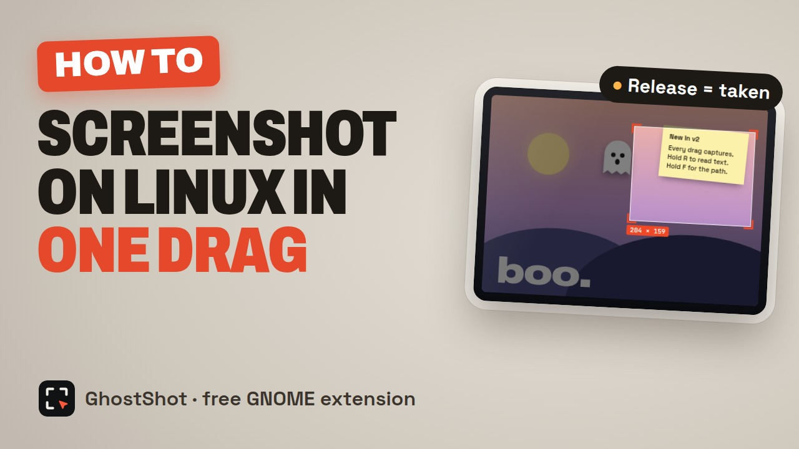
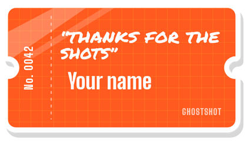

# GhostShot



[](https://extensions.gnome.org/extension/9786/instant-area-screenshot/)
[](LICENSE)
[](https://guestbook.deepanalve.dev/sign?product=ghostshot)
[](https://youtu.be/aj_5micm2Ss)

Drag, release, done. GhostShot is a GNOME Shell extension. It takes the screenshot when you let go of the mouse.

**[Install from extensions.gnome.org](https://extensions.gnome.org/extension/9786/instant-area-screenshot/)** · **[Try it on the website](https://ghostshot.deepanalve.dev)** · **[Buy me a sticker](https://guestbook.deepanalve.dev/sign?product=ghostshot)**



The website runs the same flow in your browser. Drag on the camera screen, hold `R` or `F`, and the shot prints below it.

## Watch

[](https://youtu.be/aj_5micm2Ss)

**[Launch trailer on YouTube](https://youtu.be/aj_5micm2Ss)** · **[Vertical Short](https://youtube.com/shorts/7rZP_t7S8qk)** · **[All videos on @deepanalve](https://www.youtube.com/@deepanalve)**

## What it does

- Takes the shot when you release the drag. You do not press the capture button.
- Puts the image on your clipboard, and saves it in `~/Pictures/Screenshots` as GNOME does.
- Hides the old selection box when the screenshot tool opens, so each shot starts clean.
- Drops GNOME's "Screenshot captured" toast for shots that GhostShot takes. Other notifications still show.
- Copies the text in the area when you hold `R` while you release. This needs `tesseract-ocr`.
- Copies the saved file's path when you hold `F` while you release.
- Leaves screen recording alone. A drag in recording mode never starts a recording.

## Use

1. Press `Print Screen` to open the screenshot tool.
2. Drag over an area.
3. Release the mouse. The image is on your clipboard.

| Hold while you release | Clipboard gets |
|---|---|
| Nothing | The image |
| `R` | The text in the area |
| `F` | The path of the saved file |

For text capture, install tesseract:

```bash
sudo apt install tesseract-ocr
```

## Build

```bash
scripts/build.sh
```

The script writes `dist/auto-capture@deepan.shell-extension.zip`. Install it with:

```bash
gnome-extensions install --force dist/auto-capture@deepan.shell-extension.zip
```

On Wayland, log out and back in to load a new version.

## Test

```bash
test/run-headless.sh
```

The website lives in `site/`. `site.Dockerfile` and `deploy/docker-compose.yml` serve it at ghostshot.deepanalve.dev.

The test starts a headless GNOME Shell with its own home folder and D-Bus. A driver extension drags, holds keys and reads the clipboard. Your own session does not change.

## Names

The extension ID is `auto-capture@deepan`. extensions.gnome.org cannot change an ID, so the ID keeps the first name.

## Support

<a href="https://guestbook.deepanalve.dev/sign?product=ghostshot"></a>

GhostShot stays free. If it saves you clicks, buy me a sticker. You get a one-of-one sticker made from your name, stuck on a live wall with everyone who keeps GhostShot going.

**[Buy me a sticker](https://guestbook.deepanalve.dev/sign?product=ghostshot)**

## More tools by Deepan

| Tool | What it does |
|---|---|
| [Postsound](https://postsound.deepanalve.dev) | Plays the music on Instagram photo posts in your desktop browser. |
| [GhostShot](https://ghostshot.deepanalve.dev) | Drag-to-capture screenshots for GNOME Shell. |
| [Handwriting](https://write.deepanalve.dev) | Turns typed text into realistic handwritten pages. |

## License

[GPL-3.0-or-later](LICENSE). See [NOTICE](NOTICE) for attribution. Copyright (C) 2026 Deepan Alve.
